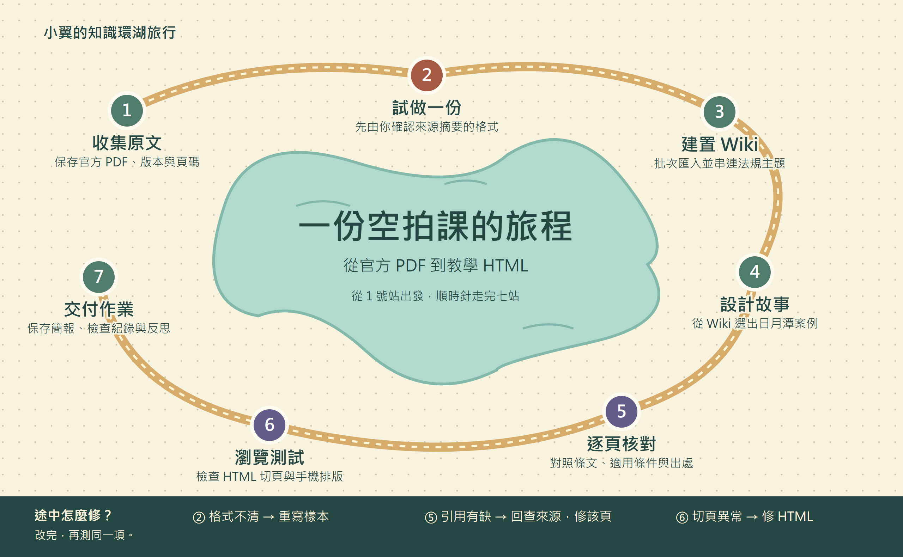

# 實作紀錄

2026-11-23｜建置階段。已核對民航局活動區域範圍查詢說明第一、二、六、七點，將圖資版本日期與查核日期分開記錄。

[Wiki 首頁](../wiki/index.md) · [來源摘要樣本](../wiki/sources/caa-map.md)

下一個節點是確認來源摘要格式。其餘官方資料、教學簡報、瀏覽測試與整體反思待後續實作。
2026-11-23｜依使用者指示完成首批 5／5。核對四份新增來源的段落、引文與日期，區分新北公告的發文日、刊登日及活動期間。尚未用個案座標判讀公告附件。
日月潭案例擴充：核對管理處表列地點、縣府附件編號與管理規則第28條。縣府附件的主公告效期待個案查核，已在來源頁標記。

## 日月潭教學簡報執行結果

[開啟教學 HTML](../slides/index.html)。本次以日月潭地點頁、文件查核頁及法規全文導覽整理八頁投影片。投010 的投影片同時連回 Wiki 摘要與原始附件第 5 頁。實際用 Chrome 在 1280 與 390 像素視窗寬度逐頁檢查，確認切頁、鍵盤返回、勾選框、練習題展開與本機連結目標。八頁皆可瀏覽，兩種寬度均無橫向溢出。

本輪瀏覽測試未發現失敗項目，無法據此判定切頁或排版為常見錯誤。內容整理時最需保留的是來源的適用限制：南投附件有可定位的頁碼，但主公告效期待查。因此先在來源摘要標記效力缺口，再把相同條件帶入地點頁和投影片。未對假設航線作飛行許可判定。
科普改版：以小翼和小葵的日月潭旅行串起 23 頁。Chrome 於 1280 與 390 像素寬度逐頁檢查切頁與橫向溢出，並測試勾選、翻答案與本機引用路徑，全部通過。

## 實際執行結果

這次我用「週末想去日月潭水社碼頭空拍」當作教學案例。原本的問題只給了一個地名，但同一個碼頭附近可能有不同的起降位置和航線。我先把問題拆成三部分：預定在哪一天飛、從哪裡起降，以及去程和回程會經過哪裡。這樣整理後，我才知道要找什麼資料，也能分辨哪些問題還缺少條件。

查核時，我從 Wiki 的日月潭地點指南找到南投縣政府的禁限飛區域附件，打開 97 頁的原始 PDF，在第 5 頁找到項次 18、編號「投010」的水社碼頭。這一列提供了圈定區域的座標，但手上的附件還不能確認主公告在預定飛行日是否有效。我把這個缺口記在來源摘要裡，並把第 10 頁投影片設計成「如何看懂公告邊界」：請讀者把起降點、去程和回程放在一起比對。實際查核得到的成果，是一個可追溯的讀圖示例；這個案例的飛行許可狀態仍待確認。

簡報完成後，我用 Chrome 分別在 1280 像素與 390 像素寬的視窗逐頁測試。兩種寬度都走完 21 頁，確認按鈕可以前進、鍵盤可以返回，第 19 頁的清單可以勾選，第 20 頁可以展開改期練習的答案。測試也檢查每一頁是否超過畫面寬度，兩種尺寸都沒有發現橫向溢出。這些結果驗證了簡報的瀏覽功能；日後實際飛行，仍要按當天的地點與時間重查公告。

## 反思與流程調整

從留下的版本來看，反覆修改最多的是「把 Wiki 內容轉成初學者看得懂的投影片」這一站。最初只有 8 頁，內容偏向查核步驟；改成 23 頁科普故事後，又發現最後兩頁可以刪去，最後保留 21 頁。版面也經過調整：原先把細節放在連結後面，讀者要中斷簡報才能理解；後來改成直接放上圖卡、例子和關鍵條文。這些是實際發生的修改，沒有逐節點的錯誤次數統計，所以我以版本變動來判斷哪一站最常返工。

我印象最深的是「250 公克以上」這句話。把條文原封不動放上去，讀者還是可能問：「剛好 250 公克算不算？」後來我把 249、250、300 公克並排，並把「自然人所有、在戶外開放空間使用」的前提寫在同一頁。這讓我發現，檢查教材時除了核對數字，還要問：讀者能不能看完這一頁，就把規則用在一個新的例子上？

我已把證據檢查提前到匯入 Wiki 的階段。以水社碼頭為例，先記下頁碼、編號與效期待查，再把它交給後面的投影片使用。下次我還會把讀者檢查提前到大綱完成後：先試做一張情境頁和一張法規頁，請初學者說說看『還缺哪些資料』和『這條規定適用於誰』。如果答案含糊，就先修改這兩頁的例子與排版，再展開整份簡報。最後才用瀏覽器驗收切頁、互動和手機版面，讓內容與操作各有明確的檢查時機。
